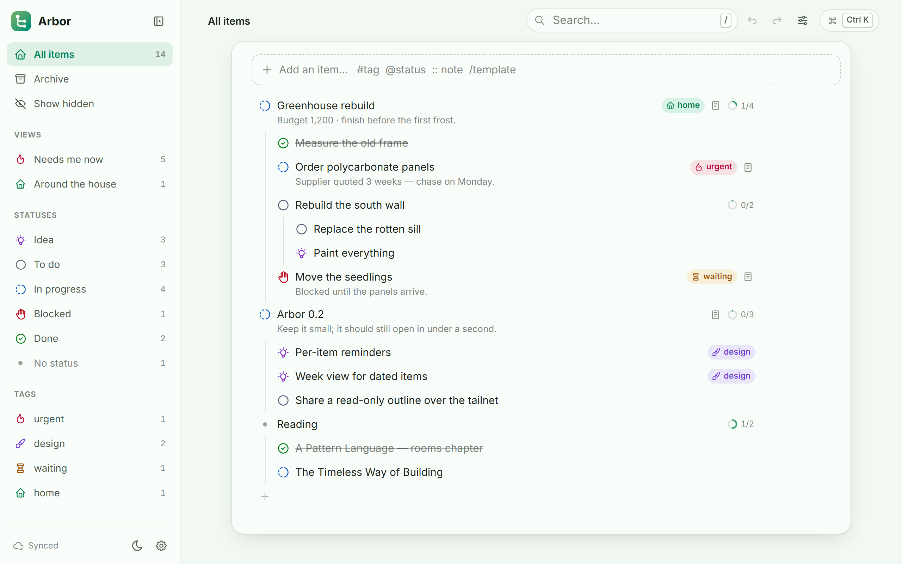

# Arbor

Self-hosted outliner for tracking projects: nested items, your own statuses and tags, notes, saved views, templates, and a phone app that works offline.



## What it does

- **Entry with no friction.** Type in the add box and press Enter. `#tag` tags it (new names create
  the tag), `@status` sets a status, `>group` sets a custom group (new names create the group),
  ` :: ` starts a note, `/template` builds a whole sub-tree, and
  Tab nests the next item under the last one. Paste an indented or bulleted list and it becomes an
  outline. Recognized tags, statuses and groups light up in their own colours while you type; new tags
  and groups get a dotted highlight. When an existing tag, status or group suggestion is highlighted, Enter confirms
  it and keeps you editing; press Enter again to add the item or make the next row. This works in
  the add box and when editing an item.
- **Outliner editing.** Enter makes the next item (splitting the text at the cursor), Tab and
  Shift+Tab change nesting, Backspace at the start merges into the row above, Ctrl+Enter marks done,
  Alt+1…9 picks a status. Drag an item by its status icon; dragging sideways changes its depth.
- **Statuses and tags you define.** Any name, any colour, any icon from the full Tabler set
  (outline and filled) or an emoji. Mark the statuses that mean *finished* and they drive progress
  rings, "hide done" and Ctrl+Enter.
- **Edit tags where you see them.** Click the pencil beside a sidebar tag or in the tag picker
  to edit its name, parent, icon, picture and colour, then Save changes. Cancel discards the draft.
  Right-click or hold a tag, or focus it and press Shift+F10, for the same editor. Each desktop item
  has a tag button for adding or removing tags without opening its actions menu.
- **Move tags with the mouse.** Drag a tag's grip in the sidebar or Settings → Tags. Drop between
  tags to reorder, on a tag to nest, or on “Move to top level” to unnest. Nested tags move with their
  parent; invalid destinations are marked and moves have Undo.
- **Dedicated tag management in Settings.** Settings → Tags shows the full tag hierarchy with item
  counts, reorder grips, edit triggers, and a unified creation form for root and nested tags.
- **Outline layouts with custom groups.** Group items into custom sections, by tag, or by status,
  and sort manually, by title, status, or timestamps without flattening your hierarchy. Collapsed
  sections stay collapsed as items update.
- **Zoom in.** Double-click a bullet or press Z to focus on that sub-tree; breadcrumbs at the top
  walk back out.
- **Fast search.** Prefix match, tags, statuses, `-negation`, exact phrases, `OR`, `AND` and
  brackets. Save any search or arrangement as a view in the sidebar.
- **Instant sync.** Multiple tabs or devices stay in sync over SSE, with optimistic local writes and
  automatic conflict resolution.
- **PWA on mobile.** Runs as a standalone app with offline support, pull-to-refresh, bottom-docked
  quick add, and haptic feedback.
- **Import and export.** Paste outlines from Markdown, WorkFlowy or Dynalist; export the whole tree
  as indented Markdown with notes.
- **Dun integration.** Link items to reminders in [Dun](https://github.com/vayne/dun) with one click.
- **Self-contained.** Single binary supervisor with embedded SQLite, automatic backups, and an
  optional Caddy proxy setup for HTTPS.

## Getting started

```sh
# Clone and install
git clone https://github.com/vayne/arbor.git
cd arbor
npm install

# Run development server (frontend + backend)
npm run dev
```

The supervisor starts both the Vite dev server and the backend on `http://localhost:3000`.

### Building for production

```sh
npm run build
npm start
```

## Configuration

Settings are stored in SQLite and can be configured through the web interface or via environment variables:

| Variable | Default | Purpose |
| --- | --- | --- |
| `PORT` | `3000` | Port for the HTTP server |
| `BIND` | `127.0.0.1` | Network interface to bind |
| `PASSCODE` | *empty* | Optional password for access |
| `DATA_DIR` | `./data` | Directory for the SQLite database and backups |
| `DUN_CONNECTION_FILE` | *auto* | Path to Dun integration connection descriptor |

### Security

When `PASSCODE` is set, a rate-limiter prevents brute-force attempts: at most 5 attempts per IP and
fifty from everyone together, within 15 minutes, and further tries are refused until the window
passes — devices already signed in are unaffected. Behind a proxy on the same machine, the client
address is taken from the proxy's `X-Forwarded-For`.

On the phone: open the site in Chrome and use *Add to Home screen*. It then opens full-screen,
starts offline and syncs when it can.

## Keyboard

Press <kbd>?</kbd> in the app for the full list. The ones worth knowing:

| Key | Does |
| --- | --- |
| <kbd>Enter</kbd> | Confirm a highlighted existing tag/status/group; otherwise next item (splits at the cursor) |
| <kbd>Tab</kbd> / <kbd>Shift+Tab</kbd> | Indent / outdent |
| <kbd>Shift+Enter</kbd> | Open the note |
| <kbd>Ctrl+Enter</kbd> | Toggle done |
| <kbd>Alt+1…9</kbd> | Set status (<kbd>Alt+0</kbd> clears) |
| <kbd>Ctrl+K</kbd> | Commands, views, templates, jump to any item |
| <kbd>/</kbd> | Search (`#tag`, `@status`, `-not`, `OR`, brackets) |
| <kbd>Z</kbd> / <kbd>Shift+Z</kbd> | Zoom into an item / back out |
| <kbd>H</kbd>, <kbd>A</kbd> | Hide, archive |
| <kbd>P</kbd> | Pin / unpin the cursor or selection |
| <kbd>G</kbd> | Move the cursor or selection into a custom group |
| <kbd>Alt+Shift+↑ ↓</kbd> | Move among siblings in custom order |
| <kbd>Shift+F10</kbd> on a tag | Edit tag name, icon and colour |
| <kbd>Ctrl+Z</kbd> | Undo (everything is undoable) |

## How it works

The server keeps every item, status, tag, view, template and setting as a JSON document in one
SQLite table with a global revision number. Clients ask for "everything since revision N", get new
revisions pushed over server-sent events, and fall back to a full snapshot if they have been away
longer than the tombstones are kept (45 days).

Each client holds the confirmed state plus its own queued writes in IndexedDB, so edits appear
instantly, survive a restart and go out when the server is reachable. Writes are field-level
patches, so two devices editing different fields of the same item both win; the same field resolves
last-write-wins. Moves that would create a loop (possible when two devices reparent offline) are
detected and broken so nothing disappears.

```
server/         HTTP + SQLite document store, and the supervisor that keeps it up
src/lib/        replica and sync, tree model, actions with undo, parsing, views, templates
src/components/ the interface
deploy/         Windows service + Caddy setup
```

## Dun reminders

Use an item's menu → **Remind me in Dun…** to choose a date and time. Arbor's server
sends the item title, notes and a link back to Dun on the same PC. Dun handles the
notification, snoozing and phone sync. Finishing or archiving the Arbor item leaves
the reminder independent; finish it in Dun when you no longer need it.

Enable **Dun → Settings → App connections** and keep Dun running in its tray.
The server reads `%APPDATA%\app.dun\integration-connection.json` on each request,
so new keys are picked up automatically. If Arbor runs as a Windows service under
another account, set `DUN_CONNECTION_FILE` to that file's absolute path. The file
can also be specified by putting its absolute path in `data/dun-connection-path.txt`.
The connection descriptor must stay private and readable only by the accounts that run the two apps.
Offline sends show an error and can be retried. Duplicate sends for the same
item and scheduled time reuse the existing reminder. The key is never sent to browsers.

## Development

```sh
npm run check   # svelte-check and the service worker's types
npm test        # unit tests plus the server's own tests
npm run build   # icon catalogues, client bundle, service worker
```

## License

MIT. See [LICENSE](LICENSE).
